# Lab Proof: First match ≠ right match

**Author:** Ayhan Demir · **Notebook:** [relevance_scoring_rerankers.ipynb](relevance_scoring_rerankers.ipynb)

## 1. What I built

A small, traceable RAG pipeline over two sources: a Trustworthy AI podcast transcript (the 2019 HLEG Ethics Guidelines) and the EU AI Act (Reg. 2024/1689, 144 pages). I built a baseline vector search, used an **LLM relevance score as my reranker** (Step 3), added **metadata filtering** with a rebuilt schema (Step 5), and plugged both into a RAG chain that **cites its sources** (Step 6). Then I evaluated 5 test queries by hand (Step 7). I also built a small local Gradio app (`app.py`) to inspect sources and answers.

```
query
  ▼ optional metadata filter      source_type / section / article (Pinecone filter)
  ▼ Pinecone top 10               text-embedding-3-small, cosine, index "lab-rerankers"
  ▼ LLM relevance score 0..1      gpt-4o-mini, one call per chunk
  ▼ combined = 0.3 × similarity + 0.7 × LLM score  →  top 5
  ▼ gpt-4o-mini, temperature 0, "answer only from context, cite [source, page, article]"
answer + the chunks used
```
| Item | Value |
|---|---|
| Chunks | 784 (20 podcast, 764 EU AI Act), 1000 characters, 150 overlap |
| Metadata (after rebuild) | `source_type`, `source_name`, `chunk_id`, `page`, `section` (recital / article / annex / transcript), `chapter`, `article`, `annex`, `char_start` |
| Switch baseline → reranked | one argument: `answer(q)` vs `answer(q, retrieve_fn=llm_rerank)` |
| Run | `pip install -r requirements.txt`, add `.env` with `OPENAI_API_KEY` and `PINECONE_API_KEY`, run the notebook top to bottom |
| Demo UI | `python app.py` |


## 1b. Process map (end to end)

How the lab works from raw sources to what the reviewer sees: build once in the notebook, then every question in the app runs retrieve, answer, view.

```mermaid
flowchart LR
    subgraph BUILD["🛠️ 1 · Build once (notebook)"]
        direction TB
        A1["📄 Sources<br/>podcast + EU AI Act"] --> A2["✂️ Chunk<br/>1000 / 150"]
        A2 --> A3["🏷️ Metadata<br/>section · article · page"]
        A3 --> A4["🔢 Embed<br/>text-embedding-3-small"]
        A4 --> A5[("🗄️ Pinecone<br/>784 vectors")]
    end

    subgraph RETRIEVE["🔍 2 · Retrieve (app)"]
        direction TB
        B1(["🙋 Question<br/>+ method · filters"]) --> B2["🎯 Metadata filter<br/>WHERE"]
        B2 --> B3["Vector search<br/>cosine"]
        B3 --> B4{"Method"}
        B4 -- "Baseline" --> B5["Top 5<br/>by similarity"]
        B4 -- "Reranked" --> B6["🤖 LLM scores top 10<br/>0.3 sim + 0.7 LLM"]
        B6 --> B7["Top 5<br/>WHICH"]
    end

    subgraph ANSWER["💬 3 · Answer (app)"]
        direction TB
        C1["🧩 Context<br/>with source labels"] --> C2["gpt-4o-mini<br/>only from context"]
        C2 --> C3["✅ Answer + citations"]
        C2 -.-> C4["🚫 I don't know<br/>based on the sources"]
    end

    subgraph VIEW["👀 4 · Reviewer view"]
        direction TB
        D1["Answer card"] --> D2["Evidence table<br/>scores · rank"]
        D2 --> D3["Chunk inspector<br/>full text + metadata"]
        D3 --> D4["⏱️ time · LLM calls"]
    end

    A5 -. "read-only" .-> B3
    B5 --> C1
    B7 --> C1
    C3 --> D1
    C4 --> D1

    classDef build fill:#E8F1FB,stroke:#4A7FC1,color:#1B3A5C
    classDef store fill:#D6E6F8,stroke:#2F5F99,color:#14304F,stroke-width:2px
    classDef step fill:#EEF7EE,stroke:#4E9A5A,color:#1E4024
    classDef llm fill:#FFF4E0,stroke:#D18A1E,color:#5A3A00
    classDef decision fill:#F3EEFB,stroke:#7B5BB5,color:#33204F
    classDef good fill:#E3F4E6,stroke:#2E7D3E,color:#14401E,stroke-width:2px
    classDef warn fill:#FDEDEF,stroke:#C2546A,color:#5A1E2A
    classDef view fill:#F5F5F7,stroke:#8A8A99,color:#2A2A35

    class A1,A2,A3,A4 build
    class A5 store
    class B1,B2,B3,B5,B7,C1 step
    class B6,C2 llm
    class B4 decision
    class C3 good
    class C4 warn
    class D1,D2,D3,D4 view

    style BUILD fill:#FAFCFF,stroke:#B9CCE6,stroke-width:1px
    style RETRIEVE fill:#FAFDFA,stroke:#BCD9C1,stroke-width:1px
    style ANSWER fill:#FFFDF8,stroke:#EBD3A8,stroke-width:1px
    style VIEW fill:#FBFBFC,stroke:#D0D0DA,stroke-width:1px
```



| Lane | What happens | Where in the code (notebook step or app.py function) |
|---|---|---|
| Build once | Load both sources, chunk them with metadata, embed them, and upload 784 vectors. | Notebook Steps 1, 2, and 5 |
| Retrieve | Apply optional metadata filters, search by cosine similarity, then optionally rerank the top 10 into the top 5. | `app.py`: `build_filter`, `baseline_search`, `llm_rerank` |
| Answer | Put source labels into the context and answer from that context with citations or the out-of-scope response. | `app.py`: `format_context`, `rag_prompt`, `answer` |
| Reviewer view | Show the answer, citation trace, evidence scores and ranks, full chunk text, elapsed time, and LLM call count. | `app.py`: `run_question`, `show_selected_chunk` |


## 2. Query

**"What fines apply for using a prohibited AI practice?"** (test query Q4)

I picked it because it's the clearest *first match ≠ right match* case in my run: the baseline's #1 chunk talks about prohibited practices, but the fines are in a different article.

## 3. Retrieved evidence

**Baseline** (plain similarity search, k = 5; notebook Step 2 and Step 6)

| Rank | chunk_id | Page | Article tag | Similarity | What the chunk contains |
|---|---|---|---|---|---|
| 1 | regulation-342 | 51 | Article 4 | 0.633 | Art 4 (AI literacy) + start of Art 5(1)(a). **No fines** |
| 2 | regulation-677 | 118 | Article 101 | 0.617 | Fines for general-purpose AI model providers (Art 101) |
| 3 | regulation-665 | 115 | Article 99 | 0.613 | **Art 99(3): Art 5 violations, up to EUR 35 000 000 or 7 % of turnover** |
| 4 | regulation-673 | 117 | Article 100 | 0.610 | Art 100(2): Art 5 violations by EU institutions, up to EUR 1 500 000 |
| 5 | regulation-675 | 117 | Article 101 | 0.584 | Use of collected fines, protection of business secrets |

**LLM reranked** (top 10 → LLM score → combined → top 5; notebook Step 3 and Step 6)

| Rank | chunk_id | Page | Article tag | Similarity | LLM score | Combined |
|---|---|---|---|---|---|---|
| 1 | regulation-665 | 115 | Article 99 | 0.613 | 1.0 | **0.884** |
| 2 | regulation-673 | 117 | Article 100 | 0.610 | 1.0 | 0.883 |
| 3 | regulation-677 | 118 | Article 101 | 0.617 | 0.8 | 0.745 |
| 4 | regulation-675 | 117 | Article 101 | 0.584 | 0.8 | 0.735 |
| 5 | regulation-635 | 108 | Article 81 | 0.573 | 0.8 | 0.732 |
| (7) | regulation-342 | 51 | Article 4 | 0.633 | 0.3 | 0.400 |

The baseline #1 (`regulation-342`) dropped to #7: the LLM saw it was about prohibitions, not fines.

## 4. Final answer (LLM reranked)

> Non-compliance with the prohibition of the AI practices referred to in Article 5 shall be subject to administrative fines of up to EUR 35,000,000 or, if the offender is an undertaking, up to 7% of its total worldwide annual turnover for the preceding financial year, whichever is higher [EU AI Act (Reg. 2024/1689), p.115.0, Article 99].

The baseline gave the same answer word for word, citing the same chunk.

## 5. Trace

| Claim in the answer | Chunk | Source text (EU AI Act, p.115, Article 99(3)) |
|---|---|---|
| Fines for non-compliance with the Article 5 prohibitions | regulation-665 | "Non-compliance with the prohibition of the AI practices referred to in Article 5 shall be subject to administrative fines…" |
| Up to EUR 35 000 000 | regulation-665 | "…of up to EUR 35 000 000…" |
| Or up to 7 % of worldwide annual turnover, whichever is higher | regulation-665 | "…or, if the offender is an undertaking, up to 7 % of its total worldwide annual turnover for the preceding financial year, whichever is higher." |

The citation label in the answer, `[EU AI Act, p.115, Article 99]`, matches the label I put into the context for this chunk, so the reviewer can go from answer → chunk_id → page → article.

**What the answer leaves out:** Article 100(2) says Art 5 violations by EU institutions are fined up to EUR 1 500 000. That chunk was #2 in the reranked context, but the answer doesn't mention it. 

## 6. Baseline vs reranked

**For Q4:** the order improved (Article 99 from #3 to #1), but the answer didn't change. The baseline top 5 already contained the right chunk, and the answer model found it.

**Across all 5 test queries** (full table in Step 7 of the notebook):

| | Baseline | LLM reranked |
|---|---|---|
| Top-1 chunk relevant | 2 Y, 1 Partial, 2 N | 4 Y, 1 Partial |
| Answer correct | 3 Y, 1 Partial, 1 N | 3 Y, 1 Partial, 1 N |
| Avg time per query | 1.7 s | 9.1 s |
| LLM calls per query | 1 | 11 (10 scores + 1 answer) |

- Reranking improved **retrieval** (Q2 and Q4 got the right chunk at #1) but not a single **answer**.
- Q2 *"What are the seven requirements for trustworthy AI?"*: after reranking, recital (27), which lists all seven, was #1, yet both methods answered "I don't know". The Act calls them "seven ethical **principles**". That's a generation problem, not a ranking problem.
- **Was it worth it?** Not in this setup: about 5x slower and 11x the LLM calls for the same answers. It would pay off with a smaller context (k = 2 to 3), a larger corpus, or as a precision step for high-stakes legal questions. The cheaper win in my run was the metadata filter: "regulation only" made the social-scoring answer cite Article 5 instead of a recital, at zero extra calls.

## 7. Failure or limitation

**Where the system gave a plausible but unsupported answer (Q1, reranked):**

For *"What AI practices are prohibited under the EU AI Act?"* the reranked answer listed three items. Item 3 reads:

> "Practices that are prohibited by Union law, including data protection law, non-discrimination law, and consumer protection laws, particularly those leading to economic or financial harms to consumers [EU AI Act (Reg. 2024/1689), p.9.0]."

It sounds right and carries a citation, but the source says the opposite of what the answer implies. Recital (45) on p.12 reads: *"Practices that are prohibited by Union law, including data protection law, non-discrimination law, consumer protection law, and competition law, should not be affected by this Regulation."* These practices are banned by **other** laws, not by the AI Act. The answer turned "not affected by this Regulation" into "prohibited under the EU AI Act" and cited p.9, although that wording is on p.12. A reader who trusts the citation would not notice.

**Why it happens:** the reranked context had more recitals *about* prohibitions, and the model merged them into a list. A citation proves that a chunk was *used*, not that the claim is *supported*.

**Other limitations I saw:**
- **LLM scores are not fully stable, even at temperature 0:** `regulation-58` scored 0.5 in one run and 0.6 in the next, which changed its rank (#6 → #5).

## 8. Demo UI (optional stretch)

- I can switch between baseline retrieval and LLM reranking, then filter by source and article.
- The evidence table shows similarity, LLM and combined scores, plus rank movement for each chunk.
- I can inspect a chunk's full text and metadata, and see the time and LLM calls for each question.
- The app runs locally only and reads the existing index without writing to it. I did not deploy it because a public URL could expose paid API usage.

for UI, run command in terminal: python app.py
then copy and paste the given link to your web browser.
