# project_structure.md: Lab "First match ≠ right match"

Module 3 track, Week 4 Day 4, required. Solo. Status: 27 Oct 2026, v3.
Repo: https://github.com/ayhandemir7-LSSBB/lab-relevance-scoring-rerankers (fork, `main`). Ayhan forks, clones and commits himself.

## 1. Brief in one paragraph
Fill in the instructor's starter notebook `relevance_scoring_rerankers.ipynb` (Steps 0 to 8) over a Trustworthy AI podcast transcript and the EU AI Act. Build a baseline vector search, improve it with LLM relevance scoring and metadata filtering, plug it into a RAG chain that cites sources, and judge with/without reranking by hand. Submit `lab_proof.md` as the reviewer's entry point via a PR.

## 2. Inputs
| File | What it is |
|---|---|
| `instructions.md`, `rubric.md`, `README.md` | Brief, 23-line grading table, submission rules |
| `relevance_scoring_rerankers.ipynb` | Instructor template: PROVIDED / YOUR TURN / OPTIONAL cells, "Done when" checks, `lab_proof.md` template |
| `data/podcast.txt` | One transcript, about 16k characters, no pages or episodes |
| `data/eu_ai_act.pdf` | Reg. 2024/1689, 144 pages: recitals p.1 to 43, Articles 1 to 113 p.44 to 123 (CHAPTER I to XIII), Annexes I to XIII p.124 to 144 |
|

## 3. Musts
| ID | Must | Template step | Rubric lines |
|---|---|---|---|
| M1 | Setup, both sources chunked with metadata, embeddings tested | Step 0, 1 | 17 |
| M2 | Baseline vector search on the 5 `TEST_QUERIES` | Step 2 | 18 |
| M3 | LLM relevance scoring + combined score + reorder | Step 3 (optional, in scope) | 3, 8, 12, 19 |
| M4 | Metadata filtering, incl. a new field and index rebuild | Step 5 | 1, 6, 21 |
| M5 | RAG chain with citations; baseline vs reranked is a 1 to 2 line swap | Step 6 | 6, 22 |
| M6 | Manual evaluation with vs without reranking, plus cost/time | Step 7 | 2, 7, 10, 11, 14, 15, 23 |
| M7 | `lab_proof.md`: query, evidence, answer, trace, baseline vs reranked, one limitation | Step 8 | Proof of Learning |
| M8 | Documented code, lab files only, no secrets | all | 16, submission |

Not covered on purpose: Step 4 dedicated reranker (rubric 4, 5, 9, 13, 20). Parked.

## 4. Pipeline
```
query
  ▼ metadata filter (WHERE)     e.g. section = article, source_type = regulation
  ▼ Pinecone top 10              text-embedding-3-small, cosine
  ▼ LLM relevance score 0 to 1   gpt-4o-mini, one call per chunk
  ▼ combined = 0.3 × similarity + 0.7 × LLM score → top 5 (WHICH)
  ▼ gpt-4o-mini, context only, cites [source, p.X]
answer + the chunks used
```

## 4b. Process map (end to end)

How the lab works from raw sources to what the reviewer sees: build once in the notebook, then every question in the app runs retrieve, answer, view.

```mermaid
flowchart LR
    subgraph BUILD["🛠️ 1 · Build once (notebook)"]
        direction TB
        A1["📄 Sources<br/>podcast + EU AI Act"] --> A2["✂️ Chunk<br/>1000 / 150"]
        A2 --> A3["🏷️ Metadata<br/>section · article · page"]
        A3 --> A4["🔢 Embed<br/>text-embedding-3-small"]
        A4 --> A5[("🗄️ Pinecone<br/>784 vectors")]
    end

    subgraph RETRIEVE["🔍 2 · Retrieve (app)"]
        direction TB
        B1(["🙋 Question<br/>+ method · filters"]) --> B2["🎯 Metadata filter<br/>WHERE"]
        B2 --> B3["Vector search<br/>cosine"]
        B3 --> B4{"Method"}
        B4 -- "Baseline" --> B5["Top 5<br/>by similarity"]
        B4 -- "Reranked" --> B6["🤖 LLM scores top 10<br/>0.3 sim + 0.7 LLM"]
        B6 --> B7["Top 5<br/>WHICH"]
    end

    subgraph ANSWER["💬 3 · Answer (app)"]
        direction TB
        C1["🧩 Context<br/>with source labels"] --> C2["gpt-4o-mini<br/>only from context"]
        C2 --> C3["✅ Answer + citations"]
        C2 -.-> C4["🚫 I don't know<br/>based on the sources"]
    end

    subgraph VIEW["👀 4 · Reviewer view"]
        direction TB
        D1["Answer card"] --> D2["Evidence table<br/>scores · rank"]
        D2 --> D3["Chunk inspector<br/>full text + metadata"]
        D3 --> D4["⏱️ time · LLM calls"]
    end

    A5 -. "read-only" .-> B3
    B5 --> C1
    B7 --> C1
    C3 --> D1
    C4 --> D1

    classDef build fill:#E8F1FB,stroke:#4A7FC1,color:#1B3A5C
    classDef store fill:#D6E6F8,stroke:#2F5F99,color:#14304F,stroke-width:2px
    classDef step fill:#EEF7EE,stroke:#4E9A5A,color:#1E4024
    classDef llm fill:#FFF4E0,stroke:#D18A1E,color:#5A3A00
    classDef decision fill:#F3EEFB,stroke:#7B5BB5,color:#33204F
    classDef good fill:#E3F4E6,stroke:#2E7D3E,color:#14401E,stroke-width:2px
    classDef warn fill:#FDEDEF,stroke:#C2546A,color:#5A1E2A
    classDef view fill:#F5F5F7,stroke:#8A8A99,color:#2A2A35

    class A1,A2,A3,A4 build
    class A5 store
    class B1,B2,B3,B5,B7,C1 step
    class B6,C2 llm
    class B4 decision
    class C3 good
    class C4 warn
    class D1,D2,D3,D4 view

    style BUILD fill:#FAFCFF,stroke:#B9CCE6,stroke-width:1px
    style RETRIEVE fill:#FAFDFA,stroke:#BCD9C1,stroke-width:1px
    style ANSWER fill:#FFFDF8,stroke:#EBD3A8,stroke-width:1px
    style VIEW fill:#FBFBFC,stroke:#D0D0DA,stroke-width:1px
```



| Lane | What happens | Where in the code (notebook step or app.py function) |
|---|---|---|
| Build once | Load both sources, chunk them with metadata, embed them, and upload 784 vectors. | Notebook Steps 1, 2, and 5 |
| Retrieve | Apply optional metadata filters, search by cosine similarity, then optionally rerank the top 10 into the top 5. | `app.py`: `build_filter`, `baseline_search`, `llm_rerank` |
| Answer | Put source labels into the context and answer from that context with citations or the out-of-scope response. | `app.py`: `format_context`, `rag_prompt`, `answer` |
| Reviewer view | Show the answer, citation trace, evidence scores and ranks, full chunk text, elapsed time, and LLM call count. | `app.py`: `run_question`, `show_selected_chunk` |

## 5. Cards
| ID | Card | Template step | Must | 
|---|---|---|---|
| L0 | Setup | Step 0 | M8 |
| L1 | Load, chunk with metadata, test embedding | Step 1 (1d) | M1 |
| L2 | Pinecone index + baseline retrieval | Step 2 | M2 |
| L3 | LLM relevance scoring | Step 3 | M3 |
| L5 | Metadata filtering + v2 schema + index rebuild | Step 5 | M4 |
| L6 | RAG pipeline with citations | Step 6 | M5 |
| L7 | Evaluation with vs without reranking | Step 7 | M6 |
| L8 | `lab_proof.md` + sanity check | Step 8 | M7, M8 |
| UI | Gradio demo app | Optional stretch | optional stretch |


## 6. Working rules (summary; full rules in `agents.md`)
**Stack:** OpenAI `gpt-4o-mini` + `text-embedding-3-small`, Pinecone `lab-rerankers`, LangChain (core, community, text-splitters, openai, pinecone), pypdf, python-dotenv. Codex in VS Code.

## 7. Parked (won't do)
Step 4 dedicated reranker (Cohere or cross-encoder) · query rewriting, HyDE, sub-query, step-back · hybrid BM25 · score threshold instead of fixed k.
